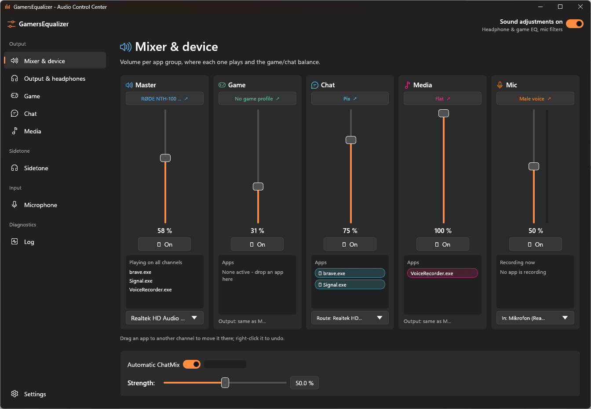
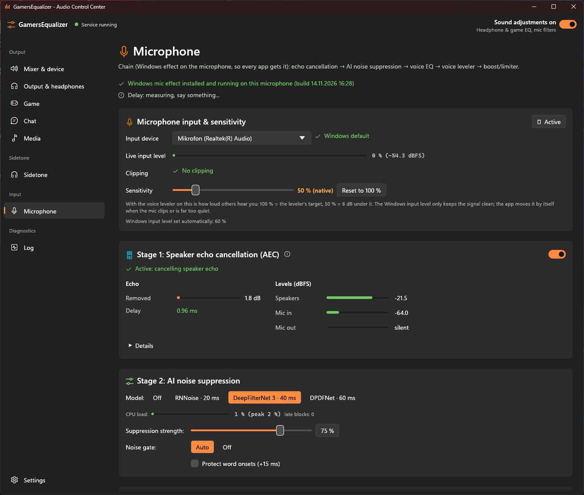

# GamersEqualizer

An audio control center for Windows, built for gamers: per-app mixer with ChatMix, headphone
correction EQ, game profiles, sidetone, and a low-latency microphone chain with echo cancellation and
AI noise suppression. It works in every app, because the processing runs as a Windows audio effect
(APO) on your real devices: no virtual sound card, no network access.

> **Status: in development.** Only a handful of people test it, while Windows setups vary enormously
> (sound cards, drivers, other audio software, Windows versions and builds). It works on the machines
> it has been tried on, but I can't guarantee it will work on yours. If something goes wrong, the app's
> log usually says why. Please send it along with your report (see
> [Reporting problems](#reporting-problems)).

## Why this exists

I have a lot of respect for what SteelSeries built with Sonar, and for the work they keep putting into
its profiles. But I mainly wanted an EQ for my headphones, and Sonar's headphone correction and game
profiles don't work together. Pick a headphone profile and the game profiles, Sonar's strongest
feature, are off the table.

After years of sending improvement suggestions that went nowhere, I decided to build the tool myself,
with Claude Opus 5.5 as my coding partner. It's software for gamers, so latency was the priority from
the first line: every stage of the microphone chain is measured, and the UI shows how much delay each
choice adds. It should be just as useful outside games.

## Features

**Mixer & ChatMix**

- Five channels: Master, Game, Chat, Media, Mic. Each has its own volume, mute, EQ profile and output
  device.
- Drag an app onto a channel to move it there. Right-click undoes the move.
- A ChatMix slider balances game against chat.

**Headphone & game EQ**

- A parametric EQ with draggable filters on a live frequency-response graph.
- Headphone correction stacks on top of game, chat and media profiles instead of replacing them.
- Import headphone profiles from [AutoEQ](https://github.com/jaakkopasanen/AutoEq), or share your own
  as text.
- Game profiles switch on their own when a known game starts.
- A game without its own profile gets a genre profile (shooter, competitive, MOBA / strategy, open
  world, story). The genre comes from a built-in list of big games, the GOG Galaxy library (which
  also covers Steam, Ubisoft, Epic and EA games connected there) and Steam's own store tags, all read
  from files on your PC. None of these launchers is required.
- Import your existing profiles from a SteelSeries Sonar install, even when Sonar itself never ran
  (SteelSeries GG kept for its hardware). Presets a later GG update brings are added on their own;
  the ones you deleted or renamed stay that way. Importing again keeps a profile you changed in the
  deleted folder before Sonar's version replaces it.
- Settings > "Back up or move settings" saves profiles and settings into one compressed JSON file
  (`.json.gz`), for a reinstalled Windows or a new PC. Export and import can be limited to some parts,
  e.g. only the game profiles for a friend, whose microphone settings stay as they are. Devices are
  found again by name, so a headset on another USB port (or the same model on the new PC) keeps its
  EQ and microphone settings.
- Loudness matching between profiles, plus a limiter so EQ boosts don't clip.
- Shows the Dolby Atmos for Headphones / spatial sound status, and can lock the output device so a GPU
  driver update can't take it over.

**Microphone chain** (installed as a Windows mic effect, so Discord, Teams, Signal, OBS and browsers all
get it)

1. Speaker echo cancellation (a Rust port of WebRTC AEC3).
2. AI noise suppression. Each model trades delay against how much noise it removes:

   | Model            | Added delay | What to expect                                                         |
   | ---------------- | ----------- | ---------------------------------------------------------------------- |
   | RNNoise          | 20 ms       | Lightest; removes very little noise                                    |
   | DeepFilterNet 3  | 40 ms       | Removes noise well; a keystroke during speech sometimes gets through   |
   | DPDFNet          | 60 ms       | Best at removing noise, but slightly changes the tone of your voice    |

3. Voice EQ, voice leveler, and boost with a limiter.

The page shows live levels, echo removed, CPU load and the measured delay.

**Sidetone**

Sealed headphones block your own voice. Sidetone plays the microphone back into them with about 20 ms
of delay. It has its own volume, noise suppression and EQ, which don't touch what the others hear.

**Also**

- A background service keeps processing audio after you close the window.
- Optional start with Windows.
- Light and dark themes.
- English and Czech.

## Honest expectations

The noise suppression won't match commercial solutions such as Krisp built into Discord or the one in
Microsoft Teams. If your calls are in an app that has those, use them. The rest of us use other apps,
and for that GamersEqualizer does the job.

## Install

Developed for Windows 11 (x64). It starts on Windows 10 version 1803 or newer and has been lightly
tested there, but trouble-free operation on Windows 10 can't be guaranteed: Windows 10 offers far fewer
audio capabilities than Windows 11.

1. Unpack the ZIP into any folder; don't run it from inside the ZIP. Keep the `.exe` and `.dll`
   together, because the app installs itself from that folder.
2. Run `gamersequalizer.exe`.
3. Click the install bar in the app and confirm the administrator prompt. The app copies itself to
   `%ProgramFiles%\GamersEqualizer\` and adds its effects to your microphone and output. Windows audio
   cuts out for a few seconds, then the installer opens the microphone briefly to check that the
   effect runs. Don't click into the installer window, because a click pauses it until you press
   Enter. Afterwards, reopen any app that had the microphone open (Discord, a game).

### Microsoft SmartScreen warning

Windows will most likely show a blue **"Windows protected your PC"** screen. The reason isn't anything
wrong with the app. Microsoft Defender SmartScreen trusts a program by its *reputation*, which builds
up as many people download and run it. GamersEqualizer has few users and isn't signed by a
commercially trusted publisher, so it has no reputation yet. Choose **More info > Run anyway**.

- **Smart App Control** (Windows 11) blocks such apps completely, and there is no "Run anyway".
  If you turn it off, Windows only lets you turn it back on by reinstalling Windows.
- Don't install any certificate to get rid of the warning. Neither SmartScreen nor Smart App Control
  accepts one you install yourself.

To update, unpack the newer ZIP, run it and click **Update**.

To uninstall, open **Settings > Uninstall from Windows**. This removes the effects from every device,
restores the original driver effects, and removes the app from Program Files and from startup. Your
settings live in `%APPDATA%\GamersEqualizer`; you can tick an option to delete them too. Once
installed, the app also appears in Windows **Settings > Apps > Installed apps** and in the Start menu,
and can be uninstalled from there (settings are kept).

**From the command line** (scripts, package managers): `gamersequalizer.exe --install` installs the
app and its effects on the microphone and output in use (on an update: where the effects already
are), `gamersequalizer.exe --uninstall` removes everything. Add `--silent` to hide the installer
window. Both ask for administrator rights once and exit with the installer's exit code.

## Troubleshooting

**The Microphone page says the mic effect isn't working (red).**

1. Click **Try another effect slot (administrator)...** and confirm the administrator prompt. Some microphones, mostly
   notebook mic arrays, start the effect in only one of two places.
2. Reopen the app that records and record for at least 15 seconds.
3. Check that audio enhancements are on: **Settings > System > Sound >** your device **> Audio
   enhancements**.

If it still doesn't work, send the log (see below).

**The output EQ doesn't change the sound.** Apps that play in exclusive mode bypass Windows audio
effects. Check that the app isn't set to exclusive mode.

## Known limits

- Built for one signed-in user per PC. With fast user switching or Remote Desktop, the signed-in users
  share the audio effect settings.

## Reporting problems

Send a short description of what you did, plus `gamersequalizer.log` from
`%APPDATA%\GamersEqualizer\logs` (paste that path into the File Explorer address bar).

If the effects seem to do nothing, start by leaving the app running. Record the microphone for at
least 15 seconds (for example with Sound Recorder) while some sound plays. Stop the recording, wait
half a minute, then send the log. It has everything needed: the state of the effects in Windows, notes
from inside the Windows audio system, crashes, and antivirus detections.

## Privacy

The app contains no network code: no telemetry, no auto-updater, no accounts. AutoEQ profiles are files
you download yourself in a browser and import.

## Credits

Built in Rust with [egui](https://github.com/emilk/egui). The microphone chain uses
[WebRTC AEC3](https://webrtc.googlesource.com/src/) (ported to Rust),
[RNNoise](https://github.com/xiph/rnnoise), [DeepFilterNet](https://github.com/Rikorose/DeepFilterNet),
DPDFNet and [Silero VAD](https://github.com/snakers4/silero-vad). Headphone data comes from
[AutoEQ](https://github.com/jaakkopasanen/AutoEq).

Not affiliated with SteelSeries. "Sonar" is a trademark of its owner.

## License

GamersEqualizer is free software under the [GNU General Public License v3.0](LICENSE) or later.
Copyright © 2026 Jiří Němec.

You may use, study, change and share it. If you distribute it or a version you changed, you must do so
under the same license, with the source code and with the copyright notices kept.

- The name "GamersEqualizer" and its logo are not part of that license. A modified version must use a
  different name and logo, and say that it is based on GamersEqualizer.
- Bundled third-party code and models keep their own licenses (MIT, Apache-2.0, BSD-3-Clause); see
  `crates/vendor/*/` and `crates/gamersequalizer-mic-vst/models/README.md`.
- The test recordings in `test_data/denoise/` are not covered. They are third-party clips for
  non-commercial use only; see the README in that folder. They are never part of the app.

Developer notes: [AGENTS.md](AGENTS.md), [docs/building.md](docs/building.md), history in
[DEVLOG.md](DEVLOG.md).
