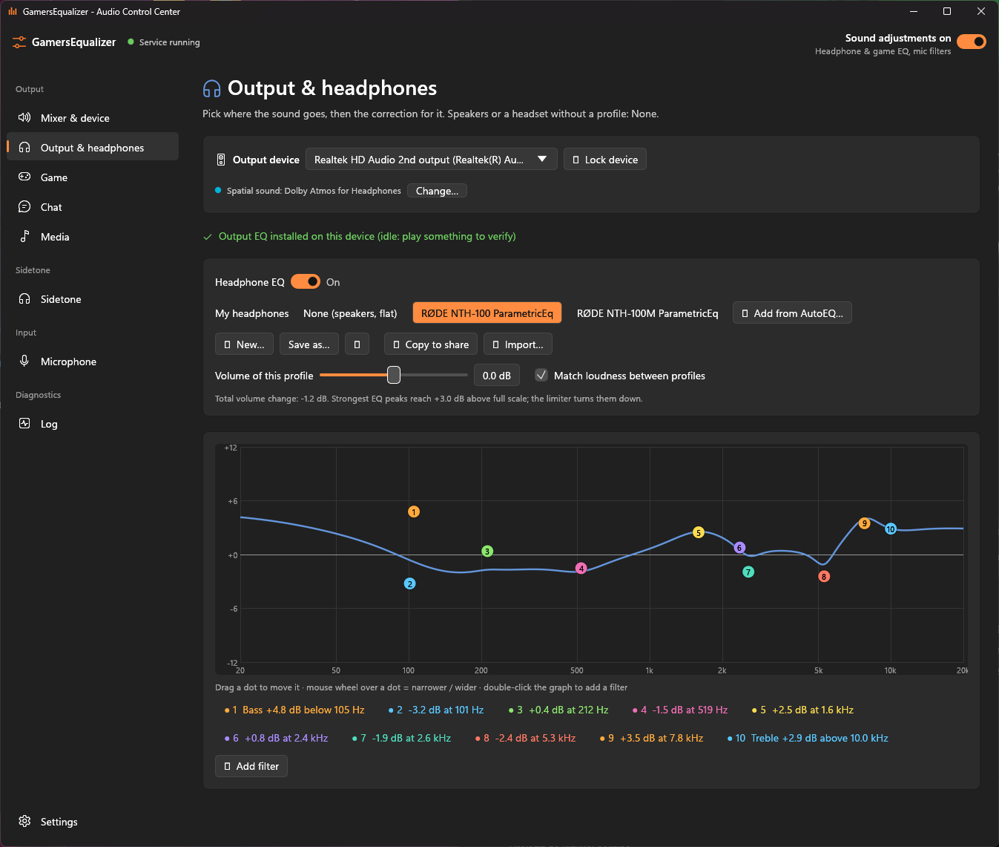
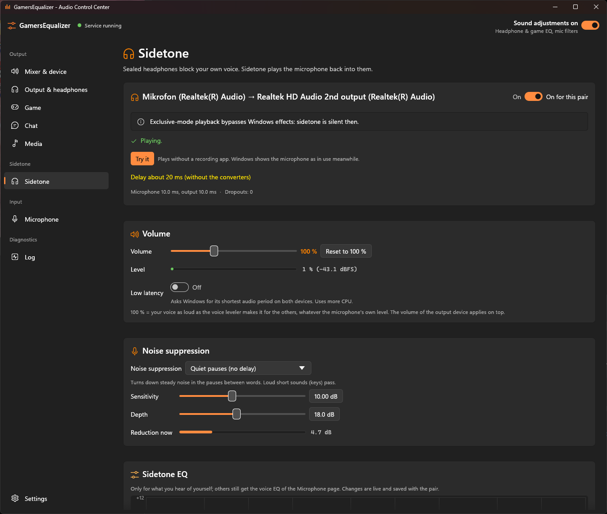

# GamersEqualizer

An audio control center for Windows, built for gamers: per-app mixer with ChatMix, headphone
correction EQ, game profiles, sidetone, and a low-latency microphone chain with echo cancellation and
AI noise suppression. It works in every app, because the processing runs as a Windows audio effect
(APO) on your real devices: no virtual sound card, no network access.

## Why this exists

I have a lot of respect for what SteelSeries built with Sonar, and for the work they keep putting into
its profiles. But I mainly wanted an EQ for my headphones, and Sonar's headphone correction and game
profiles don't work together. Pick a headphone profile and the game profiles, Sonar's strongest
feature, are off the table.

After years of sending improvement suggestions that went nowhere, I decided to build the tool myself,
with Claude Opus 5.5 as my coding partner. It's software for gamers, so latency was the priority from
the first line: every stage of the microphone chain is measured, and the UI shows how much delay each
choice adds. It should be just as useful outside games.

## Features

**Mixer & ChatMix**

- Five channels: Master, Game, Chat, Media, Mic. Each has its own volume, mute, EQ profile and output
  device.
- Drag an app onto a channel to move it there. Right-click undoes the move.
- A ChatMix slider balances game against chat.

**Headphone & game EQ**

- A parametric EQ with draggable filters on a live frequency-response graph.
- Headphone correction stacks on top of game, chat and media profiles instead of replacing them.
- Import headphone profiles from [AutoEQ](https://github.com/jaakkopasanen/AutoEq), or share your own
  as text.
- Game profiles switch on their own when a known game starts.
- Import your existing profiles from a SteelSeries Sonar install.
- Loudness matching between profiles, plus a limiter so EQ boosts don't clip.
- Shows the Dolby Atmos for Headphones / spatial sound status, and can lock the output device so a GPU
  driver update can't take it over.

**Microphone chain** (installed as a Windows mic effect, so Discord, Teams, Signal, OBS and browsers all
get it)

1. Speaker echo cancellation (a Rust port of WebRTC AEC3).
2. AI noise suppression. Pick a model by the delay you can live with:

   | Model            | Added delay |
   | ---------------- | ----------- |
   | RNNoise          | 20 ms       |
   | DeepFilterNet 3  | 40 ms       |
   | DPDFNet          | 60 ms       |

3. Voice EQ, voice leveler, and boost with a limiter.

The page shows live levels, echo removed, CPU load and the measured delay.

**Sidetone**

Sealed headphones block your own voice. Sidetone plays the microphone back into them with about 20 ms
of delay. It has its own volume, noise suppression and EQ, which don't touch what the others hear.

**Also**

- A background service keeps processing audio after you close the window.
- Optional start with Windows.
- Light and dark themes.
- English and Czech.

## Honest expectations

The noise suppression won't match commercial solutions such as Krisp built into Discord or the one in
Microsoft Teams. If your calls are in an app that has those, use them. The rest of us use other apps,
and for that GamersEqualizer does the job.

## Install

Requires Windows 10 version 1803 or newer, x64. So far it has been tried on real hardware only on
Windows 11.

1. Unpack the ZIP anywhere and run `gamersequalizer.exe`.
2. The binaries aren't signed by a trusted publisher, so Windows SmartScreen warns. Choose
   **More info > Run anyway**. Smart App Control blocks unsigned apps entirely.
3. Click install in the app. One administrator prompt copies the app to
   `%ProgramFiles%\GamersEqualizer\` and adds its effects to your microphone and output. Windows audio
   restarts for a few seconds.

To update, unpack the newer ZIP, run it and click **Update**.

To uninstall, open **Settings > Uninstall from Windows**. This removes the effects from every device,
restores the original driver effects, and removes the app from Program Files and from startup. Your
settings live in `%APPDATA%\GamersEqualizer`; you can tick an option to delete them too.

## Privacy

The app contains no network code: no telemetry, no auto-updater, no accounts. AutoEQ profiles are files
you download yourself in a browser and import.

## Credits

Built in Rust with [egui](https://github.com/emilk/egui). The microphone chain uses
[WebRTC AEC3](https://webrtc.googlesource.com/src/) (ported to Rust),
[RNNoise](https://github.com/xiph/rnnoise), [DeepFilterNet](https://github.com/Rikorose/DeepFilterNet),
DPDFNet and [Silero VAD](https://github.com/snakers4/silero-vad). Headphone data comes from
[AutoEQ](https://github.com/jaakkopasanen/AutoEq).

Not affiliated with SteelSeries. "Sonar" is a trademark of its owner.

Developer notes: [AGENTS.md](AGENTS.md), [docs/building.md](docs/building.md), history in
[DEVLOG.md](DEVLOG.md).
